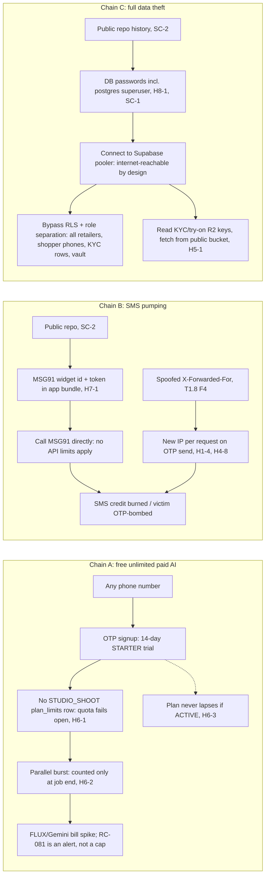

# 00 — Hacker report (merge of H1–H8)

Date: 2026-10-26. Branch `fix/team-otp-fail-closed-rc085`. Sources: `H1-auth-sessions.md` … `H7-mobile-app.md`, `H8-infra-secrets.md`. Cross-refs: `SC-ai-era-checklist-gaps.md`, T1.8, T2.5, T2.6, T2.8.
Method: code/config review plus local Fastify `inject()` harnesses. Nothing was run against production. "Plausible" means the code path is certain but no live request proved it.

## Executive summary (for the owner)

1. **Rotate every database password today.** Five Supabase role passwords, including the `postgres` superuser, are in the public git history (H8-1, SC-1). Rotation is the fix; no code change helps.
2. Five auth bugs are already fixed on this branch (RC-085..RC-089), but they are **not deployed yet**.
3. Three High bugs are still open: a URL-encoding trick that gets past the Super-Admin gate (H3-1), a public form that pulls any shopper's phone into another store's customer list (H4-1), and an AI Studio quota with no limit, so free accounts get unlimited paid AI images (H6-1).
4. Most other findings are staff/delegate overreach, cost abuse (SMS, AI), or private photos (Aadhaar KYC, try-on) stored in a public bucket. Each fix is small.
5. Several severities depend on dashboard settings only you can see; see "Owner checks". Keep the repo private or unpushed until batch 1 ships (SC-2).

## Status per finding

| ID | Sev | Status |
| --- | --- | --- |
| H1-1 Team OTP/reset fail open to `123456` | Critical | Fixed (RC-085), not deployed |
| H1-2 Team login skips admin rate limit | High | Fixed (RC-087), not deployed |
| H1-3 Plaintext OTP in prod logs | High | Fixed (RC-086), not deployed. Owner-action: purge/limit Railway log retention |
| H1-4 Retailer OTP brute force, no daily cap, spoofable IP key | Medium | Open |
| H1-5 `OTP_TEST_BYPASS` wildcard, no prod guard | Medium | Fixed (RC-088), not deployed. Owner-action: confirm bypass unset in prod |
| H1-6 Admin JWT forgeable with empty `ADMIN_API_KEY` | Medium | Fixed (RC-089), not deployed. Owner-action: confirm key set, ≥32 chars |
| H1-7 Apple review code has no attempt limit | Medium | Open (only while `REVIEW_*` vars are set) |
| H1-8 One shared admin password, no 2FA, no revocation | Low | Open |
| H1-9 MSG91 widget token replay | Low | Open (could not verify) |
| H2-1 … H2-6 | Med/Low | Open |
| H3-1 Percent-encoded path skips Super-Admin gate | High | Fixed (RC-090), not deployed |
| H3-2 Admin gate deny-list, `SUPPORT_MANAGER` full power | Medium | Fixed (RC-091), not deployed |
| H3-3 Admin gate trusts JWT role, no DB re-check | Medium | Fixed (RC-092), not deployed. Follow-up open: `team-helpers.ts:76` `verifyAdminSession` still trusts the JWT role |
| H4-1 Leads route trusts body `customer_account_id` | High | Fixed (RC-093), not deployed |
| H4-2 `/v1/customers` leaks `phone_hash` + `customer_account_id` | Medium | Fixed (RC-096), not deployed |
| H4-3 Anonymous reviews | Medium | Fixed (RC-098, RC-099), not deployed. Owner-action: apply migration 139 |
| H4-4 Legacy lead form overwrites customers, forges consent | Medium | Fixed (RC-094), not deployed |
| H4-5 Passport events accept any `retailer_id` | Low | Fixed (RC-095), not deployed. Known gap: store-level events can still be attributed to any real retailer |
| H4-6 `near-me` exposes login phone | Low | Fixed (RC-097), not deployed |
| H4-7, H4-8 | Low | Open |
| H5-1 … H5-5 | Med/Low | Open (H5-1 Owner-action) |
| H6-1 STUDIO_SHOOT quota fails open on missing `plan_limits` row | High | Fixed (RC-103), not deployed. `METERED` guard in `effectiveLimit` / `effectiveCustomerLimit` covers check, all reserve functions and both status readers; studio-shoot route 10/min. **Owner-action BEFORE deploy:** seed `STUDIO_SHOOT`, `BG_REMOVAL`, `IMAGE_CROP` (and `TRY_ON_GENERATION` if missing) for all three plans in Admin → Plan Limits, or those features refuse everyone |
| H6-2 Burst overshoots an AI cap | Medium | Partly fixed (RC-102): reserve-at-enqueue for Studio Shoot, My Style, try-on, social templates, POST /products, growth AI routes. Tagging and catalog-import AI checks left on check-then-increment. Mock tests only; scratch-DB run pending; migration 145 not applied in prod |
| H6-3, H6-4 | Low | Open |
| H7-1 … H7-4 | Med/Low | Open (H7-1, H7-4 Owner-action) |
| H8-1 … H8-6 | Crit/Med/Low | Open (H8-1 Owner-action only) |
| SC-1 / SC-2 (supply-chain report) | P0 | Open, Owner-action (rotate; make repo private) |

## Ranked open findings (H1–H8)

Effort: S ≤ ½ day, M ≤ 2 days, L > 2 days. Owner = needs a dashboard/config action or decision before or instead of code.

| # | ID | Sev | Issue | Effort | Owner |
| --- | --- | --- | --- | --- | --- |
| 1 | H8-1 | Critical | `postgres` superuser + `vault_app` passwords (plus app/migrator/purge, SC-1) in public git history, commits `541f312f`, `f624324a` | S | y |
| 2 | ~~H3-1~~ | High | Percent-encoded path segment skips the Super-Admin gate (Confirmed, local harness). Fixed RC-090, not deployed | S | n |
| 3 | ~~H4-1~~ | High | Leads route trusts body `customer_account_id`: any store pulls a shopper's phone and forges consent. Fixed RC-093, not deployed | S | n |
| 4 | ~~H6-1~~ | High | STUDIO_SHOOT quota fails open on a missing `plan_limits` row: unlimited paid AI for free accounts. Fixed RC-103, not deployed (seed Plan Limits first) | S | y |
| 5 | H8-2 | Medium | V-Tone (Hetzner, port 8000, plain HTTP): auth fails open when its secret is unset; `/try-on` fetches any URL (SSRF) | S | y |
| 6 | H5-1 | Medium | Aadhaar KYC scans and try-on results in the public R2 bucket | M | y |
| 7 | H7-1 | Medium | MSG91 widget credentials public: SMS pumping / OTP bombing that skips every API limit | S | y |
| 8 | ~~H3-2~~ | Medium | Admin gate is a deny-list; `SUPPORT_MANAGER` gets full standard-admin power (Confirmed, local harness). Fixed RC-091, not deployed | S | y (role decision) |
| 9 | ~~H3-3~~ | Medium | Admin gate trusts the team JWT role with no DB re-check. Fixed RC-092, not deployed (follow-up open: `team-helpers.ts:76`) | S | n |
| 10 | ~~H4-2~~ | Medium | `/v1/customers` leaks `phone_hash` + `customer_account_id` to masked staff. Fixed RC-096, not deployed | S | n |
| 11 | ~~H4-3~~ | Medium | Anonymous reviews: fake ratings, overwrite a real review, rename CRM customers. Fixed RC-098/099, not deployed (needs migration 139) | M | n |
| 12 | ~~H4-4~~ | Medium | Legacy lead form overwrites existing customers and forges consent. Fixed RC-094, not deployed | S | n |
| 13 | H6-2 | Medium | Check-at-route / count-at-job-end lets a burst overshoot any AI cap. Partly fixed RC-102 | M | n |
| 14 | H5-2 | Medium | detect-items and catalog presigns write unverified bytes to the public CDN | M | n |
| 15 | H5-3 | Medium | No pixel cap: decompression bomb against compress cron, ffmpeg, templates, My Style | S | n |
| 16 | H2-1 | Medium | Cross-tenant products injected into own A/B variant collection | S | n |
| 17 | H2-2 | Medium | Support session / catalog delegate reach bulk-delete and WhatsApp bulk-send | S | y (delegate scope) |
| 18 | H1-4 | Medium | Retailer OTP: no daily cap, per-IP key spoofable (T1.8 F4) | S | y (trustProxy) |
| 19 | H1-7 | Medium | Apple review code has no attempt limit | S | y (unset vars after review) |
| 20 | H8-3 | Low | CORS regex allows any `*.kanchuki.app` over plain `http` with credentials (Confirmed, local harness) | S | n |
| 21 | H4-8 | Low | Shopper OTP send has no per-route limit (SMS pumping) | S | n |
| 22 | H6-3 | Low | `plan-lapse` never lapses an ACTIVE plan whose paid period ended | S | n |
| 23 | H6-4 | Low | Self-referral check bypassed by a second phone with no GSTIN | M | n |
| 24 | H2-3 | Low | Delegates spend paid-AI quota (RC-068 shape outside try-on) | S | n |
| 25 | H2-4 | Low | Product update skips section/category/background ownership checks | S | n |
| 26 | H2-5 | Low | `GET /retailers/me` over-shares to staff and delegates | S | n |
| 27 | H2-6 | Low | Duplicate-phone error lets staff probe whether a number is a customer | S | n |
| 28 | ~~H4-5~~ | Low | Passport wishlist / recently-viewed / events accept any `retailer_id`. Fixed RC-095, not deployed | S | n |
| 29 | ~~H4-6~~ | Low | `near-me` exposes the retailer's login phone. Fixed RC-097, not deployed | S | n |
| 30 | H4-7 | Low | Passport session ids stored in plaintext | M | y (migration revokes sessions) |
| 31 | H5-4 | Low | SSRF blocklist gaps in `ssrfSafeFetch` | S | n |
| 32 | H7-2 | Low | OAuth code and staff-invite token go over a hijackable custom scheme | M | n |
| 33 | H7-4 | Low | Release keystores in the repo working tree | S | y |
| 34 | H8-4 | Low | `/health` (anonymous) returns raw DB/Redis error text (host, port) during an outage | S | n |
| 35 | H8-5 | Low | Redis TLS depends on the prod URL scheme; DEPLOY.md documents plaintext `redis://` | S | y |
| 36 | H8-6 | Low | CI: no `permissions:` block; third-party action pinned by tag in the job holding `RAILWAY_TOKEN` | S | n |
| 37 | H1-8 | Low | One shared admin password, no 2FA, no session revocation | L | y (design) |
| 38 | H1-9 | Low | MSG91 widget token replay (could not verify) | S | y (MSG91) |
| 39 | H5-5 | Low | Ken Burns raw `fetch(photo.url)` fallback (hardening, not exploitable) | S | n |
| 40 | H7-3 | Low | No certificate pinning (informational, not exploitable) | — | n |

**Reconciled 2026-10-29 against the CLAUDE.md RC tracker.** Rows 2, 3, 4, 8, 9, 10, 11, 12, 28, 29 below are Fixed locally (RC-090 … RC-098, RC-103), not deployed; row 13 (H6-2) is partly fixed (RC-102). They are kept for history and excluded from the totals.

**Totals (open): Critical 1, High 0, Medium 10, Low 19 = 30** (was 40; 10 fixed). H6-2 is counted as open until RC-102 is verified on a real DB. Dependency CVEs: see `H8-infra-secrets.md` §CVE (not in these counts). SC-1, SC-2 (P0, owner) tracked in the SC report.

## Owner checks (dashboard-only facts that set the severity)

| # | Check | Decides |
| --- | --- | --- |
| 1 | Supabase: rotate `postgres`, `kanchuki_app`, `kanchuki_migrator`, `kanchuki_purge`, `vault_app` passwords with generated random values (not a pattern); update Railway env; read Supabase pooler/auth logs for unknown IPs since 2026-07-26 | H8-1, SC-1 |
| 2 | GitHub: make `kapisejix/kanchuki` private; check GHCR package `kanchuki-tryon` visibility | SC-2, all |
| 3 | Railway: purge/limit log retention (old logs hold OTPs) | H1-3 / RC-086 |
| 4 | Railway prod env: `OTP_TEST_BYPASS` unset, `REVIEW_PHONE`/`REVIEW_OTP` unset outside App Review, `ADMIN_API_KEY` ≥32 chars | H1-5, H1-6, H1-7 |
| 5 | Staging request with `X-Forwarded-For: 203.0.113.7`: does Railway's edge overwrite or append? Then set `trustProxy` to the hop count | T1.8 F4, T2.5 F1, H1-4, H4-8 |
| 6 | R2: is the bucket public (r2.dev or custom domain)? Any WAF/deny rule on `kyc/` and `tryon/`? | H5-1 |
| 7 | R2: lifecycle rule expiring `uploads/pending/` | H5 A4 |
| 8 | Admin → Plan Limits: `STUDIO_SHOOT`, `BG_REMOVAL`, `IMAGE_CROP` rows exist for all three plans | H6-1 (set **before** the fail-closed guard deploys) |
| 9 | MSG91: widget per-number/per-IP limits, India-only routing, rotate the widget token | H7-1, H1-9 |
| 10 | EAS: credentials hold the release signing key, so the in-tree keystores can be deleted | H7-4 |
| 11 | Hetzner: `VTONE_SHARED_SECRET` set on the V-Tone box; firewall port 8000 to known IPs or put Caddy (TLS) in front | H8-2 |
| 12 | Railway API env: `REDIS_URL` scheme is `rediss://` (TLS) | H8-5 |
| 13 | Edge headers: HSTS on `kanchuki.app` (`curl -sI`) | T2.8 F4 |
| 14 | Decide `SUPPORT_MANAGER` scope and catalog-delegate delete scope | H3-2, H2-2 |

## Attack chains

Chain C works only if the passwords were never rotated; owner check 1 closes it. Chain B's API half closes with the `trustProxy` decision plus per-route limits; the widget half needs MSG91-side limits.

## Fix order (each batch = one PR, smallest blast radius first)

| Batch | Contents | Owner action first? |
| --- | --- | --- |
| 0 | Rotate DB passwords, make repo private, purge logs (owner checks 1–3). No code | **Yes, owner only** |
| 1 | Deploy this branch as is (RC-085..RC-089), already fixed and tested | Owner check 4 before deploy |
| 2 | Admin gate: H3-1 (classify on matched route), H3-3 (DB role re-read), H3-2 (allow-list) | H3-2 needs the role decision; H3-1/H3-3 can ship alone |
| 3 | Public-form trust: H4-1, H4-4, H4-3, H4-5 (session-derived ids, no body ids) + H4-2, H4-6 masking | No |
| 4 | Quotas: H6-1 fail-closed guard, H6-2 reserve-at-route, H6-3 lapse, H2-3 delegate role check | **Yes:** owner check 8 before deploy, or every studio shoot starts failing |
| 5 | SMS/OTP limits: H1-4 daily cap, H4-8 per-route limit, H1-7 attempt limit, `trustProxy` hop count | Owner check 5 |
| 6 | Uploads: H5-3 pixel cap, H5-2 verify bytes, H5-4 SSRF blocklist, H5-5 | No |
| 7 | Private media: H5-1 move `kyc/`, `tryon/` to a private bucket + signed GET | Owner checks 6–7; may need a data move |
| 8 | Staff scope: H2-1, H2-2, H2-4, H2-5, H2-6 | H2-2 delegate decision |
| 9 | Infra: H8-3 CORS regex, H8-4 `/health`, H8-6 CI permissions/pins, H8-2 V-Tone fail-closed + URL allow-list | H8-2: owner check 11 (secret set) before fail-closed ships |
| 10 | Mobile: H7-2 App Links for OAuth/invite, H7-4 remove keystores, H7-1 widget rotation | Owner checks 9–10 |
| 11 | Design items: H1-8 admin 2FA/revocation, H4-7 hashed passport sessions (migration), H6-4 referral | Owner approval (migration, design) |

Not done: no finding was re-verified at runtime during the merge; statuses come from each H report.

## T1-T3 status (checked 2026-10-29)

Source: each T report's own status text plus the CLAUDE.md RC tracker. Code was not re-read, so "open" means "the report says proposed, not applied, and no RC covers it".

Fixed:
- T2.5 F2, F3, F4 (web proxy: reviews path encoding, multi-cookie, cache headers): RC-084, applied 2026-10-25.
- T1.3 F1 (`customers.ts` masked-staff `phone_hash` leak): same root as H4-2, fixed by RC-096, not deployed.
- T1.1: `lint` scripts added to `packages/ai` and `packages/shared`, safe fixes applied. ai still 42 errors, shared 2 (deferred P2).

Open, P1: none left. Batch 4 is applied locally (below).

Fixed 2026-10-29 (Batch 4 mobile behaviour, local, not deployed, not committed):
- T3.5-a (onboarding swallows the 422 GSTIN error): RC-114. Only onboarding was swept for the `catch {}` shape.
- T3.7-a and T3.7-b (never detects offline, Mark Sold queued every failure and retried 4xx forever): RC-115. The detector was the bigger fault: with no offline signal the replay queue never ran at all. Adds `expo-network`, a native module, so it **needs an EAS rebuild** before the OTA/binary that includes it ships. The queue-file-survives-logout part of b was already fixed by RC-107.
- T3.7-c (keyboard covers inputs): RC-116. Also fixed the Edit Collection dialog, found by the new guard arm.
- T3.5-a follow-up (the `catch {}` sweep RC-114 left open): RC-117. The rule moved into `showError` itself, so every screen that calls it now shows a 4xx reason; the inline copies in help-support, staff, settings, plan-select, aggregators, templates and try-on are deleted, and the OTP-resend and try-on-payment bare catches call `showError`. Left on purpose: Facebook/Instagram/social connect (native SDK errors) and `auth/phone.tsx`. Falsified by reverting the `showError` line (4xx test goes red). Not device-tested; assumes API 4xx messages are user-readable.
- Verified: mobile vitest 258 pass (38 of 39 files at the time; the 39th, `__tests__/smoke/rc-screens.test.tsx`, was `__DEV__ is not defined`, now fixed, see the follow-up below). Not verified: any device (airplane-mode replay, keyboard on iOS/Android).

Follow-up 2026-10-29 (local, not deployed, not committed):
- T1.7 F1 sweep (bare `fetch` with no timeout in 8 more API files, 16 call sites): RC-118. Guard test added; falsified by removing one import. T2.4 (admin CSRF) re-audited across every mutating fetch under `apps/web/src/app/admin`: no further misses, no change.
- T3.5 d-h (P2 batch, mobile): d = RC-121 (`sendCampaign` 120 s + "may still be sending" copy), h = RC-120 (OTP resend sync ref), f and g (inline `setError` constants) = RC-122; e and the try-on half of g were already fixed by RC-117. Source pins in `__tests__/t35-p2-pins.test.ts`, each falsified. Left: the bulk-onboard stats swallows.
- RC-119 addendum: the keyboard guard's pin list is now derived (input components under `src/` to a fixpoint, every `app/` importer must wrap); falsified on `growth/ratings` and `onboarding`. Only `ReportProblem` stays pinned.
- RC-118 addendum: `lib/meta-catalog.ts` now defaults to a 15 s timeout (caller `signal` still wins); its only importer already passed a signal. The guard is now per call (each `fetch(` needs its own `AbortSignal.timeout`/`any`, or the file aliases `fetchWithTimeout as fetch`); the 14 files it used to exempt were read and all already had per-call timeouts. Falsified on `fal-client`.
- T3.6 b, d (P2): b = RC-124 (`allowBackup: false` in `app.json`; **needs an EAS rebuild**), d = RC-123 (dead `admin_key` / `x-admin-key` branch removed from `teamRequest`). Source pins in `__tests__/t35-p2-pins.test.ts`, each falsified. T3.6 c (26 unguarded `console.*`, optional) left on purpose.
- T3.4 c, d (P2): c = RC-127 (the report named `growth-gst.ts`; the same `z.coerce.boolean()` was at seven sites in six API files, all fixed through one `queryBool()` plus a guard), d = RC-128 (`FREE_SIZE` / stock max moved to `@kanchuki/shared`). Tests falsified; API and mobile `tsc` clean. **T3.4 b left open on purpose: the GST screen labels the retailer's own subscription payments "Sales" / "Walk-in Client", a product-copy decision for the owner.**
- T3.7 d, e (P2, mobile): d = RC-126 (`onRequestClose` on both `category/new.tsx` pickers), e = RC-125 (release text for `TIMEOUT` / `NETWORK_ERROR` in `client.ts`, URL text under `__DEV__`; the `settings` / `staff` / `ai-campaign` callers were already fixed by RC-117, `useProductAiStudio` was the live leak). Source pins in `__tests__/t35-p2-pins.test.ts`, each falsified; mobile `tsc` clean. Not device-tested.
- T3.7-c sweep (inputs owned by child components): RC-119, `growth/ratings` now wrapped. Other `src/` input components' host screens already wrapped.
- Falsification of RC-114, RC-115, RC-116 tests, each fix reverted then restored: RC-115 `isRetryable` (4 cases + replay case red), RC-115 `setupOnlineManager` (red), RC-115 dequeue line (red, isolated), RC-116 guard (red). RC-114 had a gap: its tests covered `apiMessage` only, so reverting an onboarding catch stayed green; a source-pin for the three onboarding catches was added and then falsified (red).
- `rc-screens.test.tsx` now loads and passes (5/5): `__DEV__` via `vi.hoisted`, `expo-file-system` mocked, real `ApiError` in the RC-009 case, RC-008 fixture converted to paise (it had been stale since RC-109). Checked against `main` 2026-10-29 (`0b886a3e`, throwaway worktree): `main`'s own `rc-screens.test.tsx` passes 5/5 there, and the same file run against this branch's code fails to load with `ReferenceError: __DEV__ is not defined`. So the breakage was NOT pre-existing: it came in with this branch (RC-117's `showError` reads `__DEV__`; RC-109 changed the money fixtures), and the test edits above were the fix. No app bug; test-environment only. The 3 typed-route `tsc` errors were a stale gitignored `.expo/types/router.d.ts` (Oct 16, older than the `/enquiries` routes); regenerated by a 60 s `expo start`, mobile `tsc --noEmit` is now clean.
- Verified: API 183 pass across the 10 related suites, API `tsc` clean; mobile 184 pass across `src/lib`, `src/hooks`, the keyboard guard and `rc-screens`, mobile `tsc` clean. Not verified: any device, real Meta/Google/Razorpay/WhatsApp, Postgres.

Fixed 2026-10-29 (Batch 1, local, not deployed, not committed):
- T2.8 F2 (sitemap lists shopper-specific collections): RC-105.
- T2.8 F1 (service worker caches personal responses): RC-106.
- T3.6-a (forced logout keeps old account data): RC-107.

Fixed 2026-10-29 (Batch 2 money and Batch 3 admin + observability, local, not deployed, not committed):
- T1.8 F1 (add-on callback 401 before the handler): RC-108.
- T3.4-a (GST report shows paise as rupees, mobile and admin web): RC-109.
- T1.7 F1 and T3.5-c (outbound fetch with no timeout; Resend, Meta Graph, Razorpay, mobile pay): RC-110.
- T3.5-b (campaign sent twice): RC-111. No migration was needed; `SENT` already exists, so the claim is a conditional update before dispatch.
- T2.4 F1, F2, F3 (admin SQL console and social Disconnect skip CSRF, failure swallowed, rejected token cached): RC-112.
- T1.4 F1 (failed BullMQ jobs never reach Sentry): RC-113.
- Verified: API tests 85 passed in the changed suites and 792 across plugins, jobs, team, retailers and meta-graph, web 6 and mobile 3 new tests pass, API and web `tsc` clean, mobile `tsc` shows only the 3 typed-route errors already open. Nothing was run against real Postgres, Razorpay, Meta, a browser or a device.

All 15 P1s above were re-read against current code on 2026-10-29 and were still real before Batch 1.

Open, P2 (not applied): T1.2, T1.3 F2-F3, T1.4 F2-F4, T1.5, T1.6, T1.7 F2-F6, T1.8 F2-F5, T2.1, T2.2, T2.3, T2.4 F4-F6, T2.5 F5, T2.6, T2.7, T3.1, T3.2, T3.3, T3.4 b, T3.5 g (stats swallows only), T3.6 c.

Waiting on an owner decision: T1.8 F4 and T2.5 F1 (`trustProxy`, same as H1-4).
